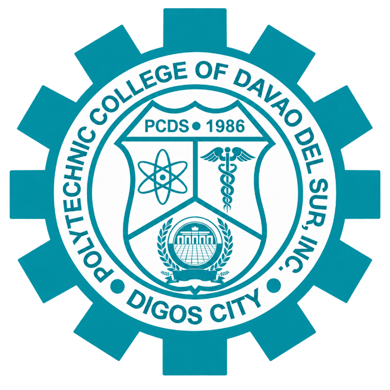
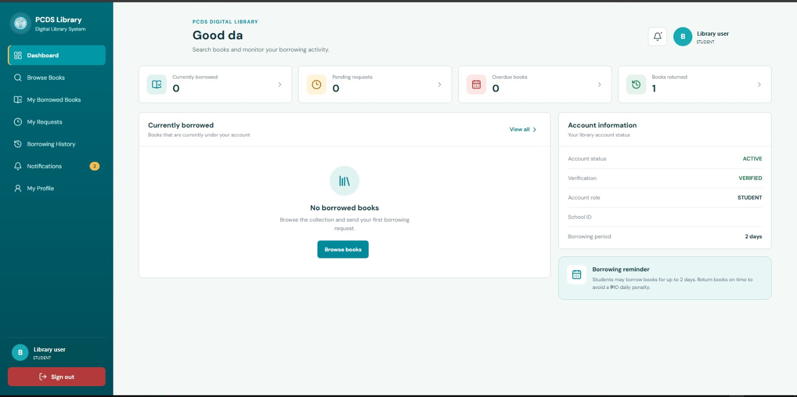
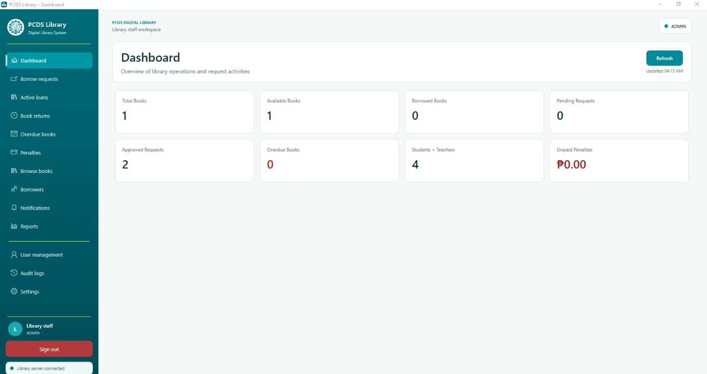

<p align="center">
  
</p>

<h1 align="center">PCDS Library</h1>

<p align="center"><strong>A digital library and circulation system for Philippine Christian Discipleship School (PCDS).</strong></p>

<p align="center"><a href="https://pcds-library.vercel.app/"><strong>Visit the Live Library Portal →</strong></a></p>

PCDS Library brings book discovery, borrowing, and library operations together in one system. Students and teachers can browse the collection and keep track of their requests and loans, while library staff can manage books, circulation, borrowers, and reports.

## Screenshots

### Borrower dashboard

Students and teachers can review their account status, current loans, pending requests, overdue books, and notifications.



### Library staff dashboard

Library staff can see an overview of the collection, requests, loans, overdue books, penalties, and borrower activity.



## Features

- **Book catalog:** Browse and search books by title, author, ISBN, and library identifiers.
- **Borrowing workflow:** Submit borrowing requests and follow their status.
- **Loan tracking:** Review active loans, due dates, overdue items, and borrowing history.
- **Library operations:** Manage books, requests, returns, borrowers, notifications, and library settings.
- **Account and access management:** Support for student, teacher, librarian, and administrator roles, with profile verification and role-based access.
- **Monitoring and reports:** View library summaries, penalties, and audit logs.
- **Web and desktop clients:** Use the React web application or the Windows desktop application for library staff.

## Technology

| Area | Technologies |
| --- | --- |
| Web frontend | React, Vite, React Router |
| API | Python, Flask, Flask-JWT-Extended |
| Database | MySQL, SQLAlchemy, Flask-Migrate |
| Desktop application | C#, WPF, .NET 10 |

## Run locally

### Requirements

- Python 3.10 or later
- Node.js and npm
- MySQL
- Windows and the .NET 10 SDK to build the desktop application

### 1. Configure the backend

Create a MySQL database, then configure the backend environment:

```powershell
cd backend
py -m venv .venv
.\.venv\Scripts\Activate.ps1
pip install -r requirements.txt
Copy-Item .env.example .env
```

Update `backend/.env` with your local MySQL connection string and the required application settings. Configure Google OAuth and email settings if you want to use those features. Keep `.env` private; do not commit credentials or secrets.

Apply database migrations and start the API:

```powershell
python -m flask --app run db upgrade
py run.py
```

The API runs with Flask's development server. For deployment, use a production WSGI server and configure the environment and database for your hosting platform.

### 2. Run the web frontend

In a second terminal:

```powershell
cd frontend
npm install
npm run dev
```

Open the local URL printed by Vite, usually `http://localhost:5173`.

### 3. Build the Windows desktop application

From the repository root:

```powershell
dotnet build .\PCDSLibrary.Desktop\PCDSLibrary.Desktop\PCDSLibrary.Desktop.csproj
```

## Desktop installer

Windows users can download the latest **PCDS Library Desktop** installer from the [GitHub Releases](https://github.com/nardvyn/PCDS-library/releases/latest) page. The published x64 installer is self-contained and does not require a separate .NET runtime installation.

## Repository layout

```text
backend/                 Flask API, database models, routes, and migrations
frontend/                React web application
PCDSLibrary.Desktop/     Windows WPF desktop application and installer
docs/screenshots/        Project screenshots used in this README
```
